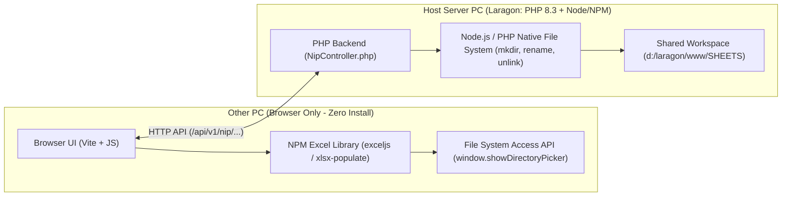

# CHO MARAWI PORTAL — EXCEL, FILE SYSTEM & CLIENT/SERVER ENGINEERING PLANNER

**Document Path:** `d:\laragon\www\CHO-System\EXCEL_AND_FILESYSTEM_PLANNER.md`  
**Date:** November 11, 2026  
**Topic:** Eliminating Python Dependency & Designing File/Folder Manipulation Logic for Host PC & Client PCs on the Network

---

## 1. The Core Problem Statement

Currently, our Excel manipulation scripts ([`nip_modernizer.py`](file:///d:/laragon/www/SHEETS/nip_modernizer.py) and [`nip_workbook_engine.py`](file:///d:/laragon/www/SHEETS/nip_workbook_engine.py)) rely on **Python + `openpyxl`**.
- **Problem 1 (Dependency):** If we deploy or run `CHO-System` on another PC that only has Laragon (PHP + Node/NPM) or if a client PC connects over the LAN/Wi-Fi (`http://192.168.1.226/...`), requiring Python + `pip install openpyxl` on machines is fragile and adds setup friction.
- **Problem 2 (File & Folder Manipulation):** What if the system needs to:
  1. Create folders at a specific path (e.g., `CHO-Reports/2027/Q1/`),
  2. Rename or move folders/files,
  3. Modify existing `.xlsx` files in-place without corrupting the 8,500+ Excel formulas?
- **Question:** Can JavaScript do this directly? Do other PCs need to install anything, or run a `.bat` script? What is the cleanest, most professional engineering architecture?

---

## 2. Understanding the Two Scenarios: Server Storage vs. Client PC Local Disk

In web engineering, there is a strict boundary between **the Host Server (Laragon PC)** and **the Client Browser (Other PCs on the network)**. Here is what each side can do natively without Python:



---

## 3. Scenario A: Manipulating Files & Folders on the Centralized Server (`d:\laragon\www\SHEETS`)

If all users on the network work off the **Centralized Server Repository** (the Laragon host PC stores the master files, folders, and backups, and other PCs access them through the Web Dashboard):

### Do other PCs need to install anything?
**NO.** Other PCs only open their browser (`Chrome` / `Edge`). All file/folder operations happen on the server via API requests.

### How do we replace Python on the Server?
We have **two zero-Python options** already built into your stack:

#### Option A1: Node.js + NPM (`exceljs` or `xlsx-populate`) + Node `fs` module
Since the project already uses **Node.js & NPM** (for Vite), we can install **`xlsx-populate`** or **`exceljs`** via `npm install`:
- **Why `xlsx-populate` or `exceljs` instead of SheetJS (`xlsx` community)?**
  - Standard free SheetJS (`xlsx`) strips styling and cell colors unless you buy their Pro version.
  - **`xlsx-populate`** and **`exceljs`** are 100% free, open-source NPM packages that **preserve all existing styles, colors, borders, merged cells, and 8,500+ formulas** when modifying cell values!
- **Folder & File Manipulation in Node.js (`fs/promises`)**:
  - Create folders: `fs.mkdir('d:/laragon/www/SHEETS/2027/Q1', { recursive: true })`
  - Rename files/folders: `fs.rename(oldPath, newPath)`
  - Delete/Move files: `fs.unlink()`, `fs.copyFile()`

#### Option A2: Native PHP 8.3 (`ZipArchive` + XML or `PhpSpreadsheet`)
Since Laragon runs PHP 8.3 natively:
- PHP has built-in `mkdir()`, `rename()`, `unlink()`, `scandir()`, and `copy()` functions that manipulate any folder or file on the server in `< 1ms` with zero external dependencies.
- Even better: An `.xlsx` file is literally a standard `.zip` archive containing XML files (`xl/worksheets/sheet1.xml`). PHP's native `ZipArchive` or `Node.js` with `xlsx-populate` can edit cell values directly without needing Python installed!

---

## 4. Scenario B: Manipulating Files & Folders Directly on the User's Own PC (`C:\` or `D:\` of the Client PC)

What if a user on **PC #2** wants the web app to **create folders, rename files, and save modified `.xlsx` files directly into a specific folder on PC #2's hard drive** (for example, `D:\CHO_MARAWI_LOCAL\2027\`)?

Normally, browsers block websites from touching arbitrary paths on a user's hard drive for security. **However, there are 3 real engineering solutions**, ranked from best to most advanced:

### Solution 1: HTML5 File System Access API (100% Pure JavaScript in Browser — ZERO Install!)
Modern Chrome and Microsoft Edge have a built-in native API called the **File System Access API** (`window.showDirectoryPicker()`).

#### How the Engineering Logic Works:
1. **User Grants Folder Access Once:**
   - The user clicks **"Connect Local Workspace Folder"** on the NIP Dashboard.
   - Chrome/Edge pops up a folder picker. The user selects e.g. `Documents\CHO-NIP-Workspace`.
   - We save the `FileSystemDirectoryHandle` inside **IndexedDB** (so the browser remembers the folder across page reloads!).
2. **What Pure Frontend JavaScript Can Now Do Inside That Folder:**
   - **Create Subfolders Automatically:**
     ```javascript
     const yearFolder = await rootHandle.getDirectoryHandle('2027', { create: true });
     const q1Folder   = await yearFolder.getDirectoryHandle('Quarter_1', { create: true });
     const backupDir  = await rootHandle.getDirectoryHandle('backups', { create: true });
     ```
   - **Read & Modify `.xlsx` in Memory (via NPM `xlsx-populate` / `exceljs` bundled by Vite):**
     - JS reads the `.xlsx` file from the user's folder (or downloads the template from the server), clears the raw Male/Female cells or updates `C5`/`G5`/`I5`, and writes the modified `.xlsx` binary **directly back to the user's local folder** (`FileSystemWritableFileStream`)!
   - **Delete or Rename Files/Folders:**
     - `await rootHandle.removeEntry('old_file.xlsx')`
     - Copy/Rename by writing the new file handle and removing the old entry.
3. **Pros & Cons:**
   - **Pros:** **Zero installation** on client PCs (no Python, no Node, no `.bat` file needed on client PCs). Works over LAN/Wi-Fi.
   - **Cons:** Only has access to the folder (and all its subfolders) that the user selected once, and requires Chrome/Edge (note: over LAN HTTP `192.168.x.x`, Chrome treats local origin or requires a 1-time flag if not `localhost`/`https`).

---

### Solution 2: Bundled NPM Excel Engine on the Host Server + Auto-Sync / ZIP Download
If we want **zero browser security prompts** and **zero installs on client PCs**:

1. **All Folder & Excel Logic Runs via NPM (`xlsx-populate` / `exceljs`) + PHP on the Host Server:**
   - We replace `nip_workbook_engine.py` with a Node.js script (`backend/scripts/nip_engine.mjs`) powered by our `package.json` dependencies.
   - Anyone who clones the project on a new server just runs `npm install` (which they already do for Vite/Tailwind/Flowbite!).
2. **Full File & Folder Manager UI in the Web Portal:**
   - In the NIP Dashboard, we provide a **Workspace File Explorer** where users can:
     - Create folders (`2026/`, `2027/`, `backups/`, `Q1_Reports/`)
     - Rename files & folders
     - Duplicate / Reset quarters / Generate New Year workbooks
     - Download single `.xlsx` files or an entire structured folder as a `.zip` archive.

---

### Solution 3: Lightweight Local Bridge / Portable Batch Launcher (`.bat`) — Only if Unrestricted `C:\` / `D:\` Path Access is Required on Client PCs
What if you literally want the website to write to a hardcoded path like `C:\CHO-System-Files\NIP\2027\` on a client PC **without even asking the user to pick a folder**?

Because browsers strictly forbid silent hardcoded path access (`C:\...`), doing that on a client PC requires a tiny local helper:
- A 1-click **`setup-client-bridge.bat`** file that starts a tiny portable Node.js/PHP local agent on `127.0.0.1:9876`, **OR** wrapping the web app in **Electron / Tauri**.
- **Verdict:** Usually overkill unless offline standalone desktop mode is required!

---

## 5. Head-to-Head Comparison Matrix

| Capability / Requirement | Current (Python `openpyxl`) | Recommended: **NPM (`xlsx-populate` / `exceljs`) + PHP Native FS** | Optional Add-on: **Browser File System Access API** |
| :--- | :---: | :---: | :---: |
| **Requires Python Installed?** | ❌ Yes (`python` + `openpyxl`) | ✅ **NO** (Uses existing Node/NPM & PHP) | ✅ **NO** (Runs 100% in browser JS) |
| **Preserves 8,500+ Formulas & Styles?** | ✅ Yes | ✅ **Yes (`xlsx-populate` / `exceljs`)** | ✅ **Yes (Bundled via Vite)** |
| **Create / Rename / Delete Folders on Server?** | ⚠️ Via Python `os` | ✅ **Yes (Native PHP `mkdir`/`rename` & Node `fs`)** | N/A (Target is Client Disk) |
| **Create / Rename / Modify Files on Client PC Disk?** | ❌ No (Server only) | ⬇️ Via Browser Download / Upload | ✅ **Yes (Direct Read/Write to User Folder)** |
| **Works for Other PCs on LAN/Wi-Fi?** | ⚠️ Only if Host has Python | ✅ **Yes, 100% out of the box** | ✅ **Yes** |
| **Setup Needed for Developers?** | Install Python + pip packages | **Just `npm install`** (Already used!) | **Just `npm install`** |

---

## 6. Recommended Engineering Blueprint for `CHO-System`

To make `CHO-System` **100% self-contained** (zero Python required anywhere, works on any PC that runs `npm install` + PHP):

### Phase 1: Replace Python Engine with NPM `xlsx-populate` (or `exceljs`)
1. Run `npm install xlsx-populate` (or `exceljs`) in `d:\laragon\www\CHO-System`.
2. Create [`backend/scripts/nip_workbook_engine.mjs`](file:///d:/laragon/www/CHO-System/backend/scripts/nip_workbook_engine.mjs) using Node.js.
   - **Port all 3 commands from `nip_workbook_engine.py`:**
     - `create-year`: Loads template `.xlsx`, updates `DASHBOARD` cells (`C5`, `G5`, `I5`), clears raw Male/Female input cells across `per brgy & Q1..Q4` while keeping all 8,500+ formulas & cell styles 100% intact, and saves to the target folder.
     - `reset-quarter`: Clears Q1–Q4 (or Month 1–3) raw Male/Female cells in-place.
     - `get-kpis`: Reads cached values from `DASHBOARD` and `per brgy` sheets and returns JSON to `NipController.php`.

### Phase 2: Native PHP File & Folder Manager (`NipController.php`)
Expand [`NipController.php`](file:///d:/laragon/www/CHO-System/backend/controllers/NipController.php) with clean file-system endpoints using native PHP (`mkdir`, `rename`, `unlink`, `scandir`):
- `POST /api/v1/nip/folders/create` — Create new subfolders inside `SHEETS` (e.g., `2026`, `2027`, `backups`, `archives`).
- `POST /api/v1/nip/files/rename` — Rename any `.xlsx` workbook or folder safely.
- `POST /api/v1/nip/files/move` — Move workbooks between folders (e.g., move old files to `backups/`).
- `DELETE /api/v1/nip/files/delete` — Delete unwanted test workbooks.
- `GET /api/v1/nip/files/download` — Direct download of any `.xlsx` file to the client PC.

### Phase 3: Client-Side Local Folder Sync (Browser `showDirectoryPicker` + Vite Bundle)
For users on other PCs who also want a **local folder structure automatically created and updated on their own PC**:
- Add a **"Local Folder Sync"** button in the NIP Dashboard (`frontend/assets/js/modules/nip-files.js`).
- When clicked, the browser uses `window.showDirectoryPicker()` to let the user pick a folder on their PC, automatically creates `\2026`, `\2027`, and `\backups` subfolders on their machine, and saves generated `.xlsx` files directly into their local folder!

---

## 7. Actionable Next Steps (Ready to Execute on Approval)

1. **Install NPM Excel Engine:** Run `npm install xlsx-populate` in `d:\laragon\www\CHO-System`.
2. **Build Node.js Engine (`nip_workbook_engine.mjs`):** Port `nip_workbook_engine.py` to Node.js so Python is no longer required.
3. **Add Folder/File Manipulation APIs in `NipController.php`:** Add Create Folder, Rename File/Folder, Move to Backup, and Download endpoints.
4. **Integrate into `/frontend/pages/NIP/dashboard/`:** Connect the UI controls so users can manage workbooks, folders, and KPIs seamlessly from any PC on the network.

